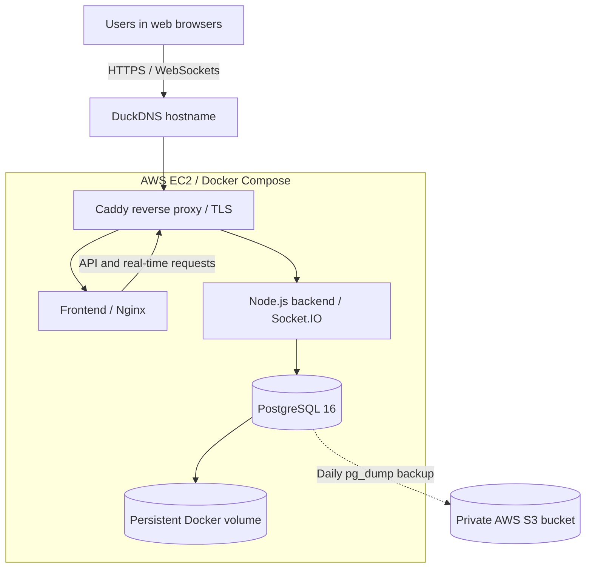

# Product-Brainstorm

### Real-Time Collaborative Whiteboard | React • TypeScript • Socket.IO • PostgreSQL • AWS

[](https://productbrainstormv2.duckdns.org/)
[](https://react.dev/)
[](https://www.typescriptlang.org/)
[](https://socket.io/)
[](https://aws.amazon.com/ec2/)

**Product-Brainstorm** is a browser-based collaborative whiteboard for teams to brainstorm, sketch, organize ideas, and work together on a shared canvas in real time. It combines responsive canvas interactions with live collaboration and a containerized cloud deployment.

**[Launch the Live Application](https://productbrainstormv2.duckdns.org/)** · **[Source Code](https://github.com/anmol12-gib/Product-Brainstorm)**

> The application is publicly reachable while its AWS server is running. Board-specific collaboration links should be shared only with intended participants.

## Features

- **Real-time collaboration:** Synchronizes whiteboard objects between connected participants using Socket.IO.
- **Live collaborator cursors:** See other participants' cursor positions while working.
- **Presence awareness:** Reflects collaborators joining and leaving a board.
- **Freehand drawing:** Sketch ideas directly on the canvas.
- **Shapes and diagrams:** Create and manipulate rectangles, circles, triangles, and other supported objects.
- **Sticky notes and text:** Capture ideas and annotate designs.
- **Object editing:** Select, move, resize, and modify canvas elements.
- **Pan and zoom:** Navigate a large workspace smoothly.
- **Undo and redo:** Reverse or reapply supported editing actions.
- **Persistent boards (deployed version):** PostgreSQL-backed storage retains board data across page refreshes.
- **Shareable collaboration:** Open the same board in separate browser sessions to work together.

## Live Deployment

**Production URL:** https://productbrainstormv2.duckdns.org/

The production application is hosted on **Amazon EC2** and uses **Docker Compose** to coordinate its services. **Caddy** handles HTTPS and reverse-proxy routing, with **DuckDNS** providing the public hostname. The production database runs on **PostgreSQL 16** with a persistent Docker volume.

### Production architecture



### Infrastructure and operations

| Area | Implementation |
| --- | --- |
| Hosting | AWS EC2 (Ubuntu Linux) |
| Containers | Docker and Docker Compose |
| Frontend | React, TypeScript, Vite, Nginx |
| Backend | Node.js, Express, Socket.IO |
| Database | PostgreSQL 16 with persistent storage |
| Reverse proxy and HTTPS | Caddy with automated TLS certificate management |
| Public hostname | DuckDNS |
| Backups | Daily compressed PostgreSQL dumps uploaded to private, encrypted Amazon S3 |
| Backup schedule | 02:00 UTC daily (07:30 IST) |
| Local backup cleanup | Daily cleanup of older local backups |
| AWS access for backups | EC2 IAM instance profile; no static AWS access keys required |

> **Operational note:** Scheduled backups have been configured and manually tested. Continue monitoring the first unattended run, and perform a test restore before treating backups as fully disaster-recovery verified. The EC2 public IP can change after a stop/start, requiring an update to the DuckDNS record.

## Technology Stack

| Layer | Technologies |
| --- | --- |
| UI | React 19, TypeScript, Tailwind CSS, Lucide React |
| Frontend tooling | Vite 7, ESLint |
| Client state | Zustand |
| Real-time communication | Socket.IO client/server |
| Server | Node.js, Express |
| Production persistence | PostgreSQL 16 |
| Infrastructure | AWS EC2, Docker Compose, Nginx, Caddy, Amazon S3, IAM |

## Getting Started (Development)

### Prerequisites

- Node.js and npm
- Git
- A modern browser

### 1. Clone the repository

```bash
git clone https://github.com/anmol12-gib/Product-Brainstorm.git
cd Product-Brainstorm
```

### 2. Install frontend dependencies

```bash
npm install
```

### 3. Install backend dependencies

```bash
cd whiteboard-backend
npm install
```

### 4. Start the backend

From `whiteboard-backend/`:

```bash
npm start
```

### 5. Start the frontend

In a **second terminal**, from the repository root:

```bash
npm run dev
```

Open the local URL printed by Vite (typically `http://localhost:5173`). Check your local backend/API configuration if the frontend cannot connect to the Socket.IO server.

> **Repository/version note:** The publicly visible `main` branch currently contains `src/`, `public/`, and `whiteboard-backend/`. The AWS deployment described here also uses a `deployment/` directory on the EC2 server. Commit the deployment configuration (without secrets) if you want others to reproduce that exact production setup from GitHub.

## Production Deployment (AWS EC2)

The deployed server uses a production Compose file at `deployment/compose.prod.yml` and an environment file at `deployment/.env`.

**Prerequisites:** A configured Ubuntu EC2 instance, Docker Engine, Docker Compose, a domain or subdomain pointing to the server, and inbound HTTP/HTTPS access.

1. Clone the project onto the EC2 instance and enter the repository directory.
2. Prepare `deployment/.env` with the production variables required by the Compose configuration, including `DOMAIN` and `POSTGRES_PASSWORD`. Keep this file private and out of version control.
3. Validate the Compose configuration:

   ```bash
   docker compose --env-file deployment/.env -f deployment/compose.prod.yml config
   ```

4. Start the production services:

   ```bash
   docker compose --env-file deployment/.env -f deployment/compose.prod.yml up -d --build
   ```

5. Inspect service health:

   ```bash
   docker compose --env-file deployment/.env -f deployment/compose.prod.yml ps
   ```

6. Open your HTTPS domain and test saving a board, refreshing, and collaborating from two browser sessions.

> Do not commit `.env` files, database dumps, AWS credentials, DuckDNS tokens, or board access links. Avoid exposing the PostgreSQL port publicly. Use a dedicated IAM role with least-privilege access for S3 backup uploads.

## Database Backups

The production deployment includes `deployment/backup.sh`, which creates a compressed PostgreSQL dump and, when `BACKUP_S3_URI` is configured, uploads it to Amazon S3 with AES-256 server-side encryption.

Example manual backup on the deployed server:

```bash
cd ~/Product-Brainstorm
sudo bash -c 'set -a; source deployment/.env; set +a; bash deployment/backup.sh'
```

The server has a daily cron schedule for backups and a separate schedule for local backup cleanup. S3 backups are not removed by the local cleanup job. Verify backup logs, S3 object retention, and periodic restore procedures as part of ongoing maintenance.

## Project Layout

```text
Product-Brainstorm/
├── public/                  # Static frontend assets
├── src/                     # React / TypeScript application
├── whiteboard-backend/      # Node.js / Socket.IO backend
├── package.json             # Frontend dependencies and scripts
├── vite.config.ts           # Vite configuration
└── README.md

# Production server also has deployment/ configuration:
# deployment/compose.prod.yml, deployment/backup.sh, deployment/.env
```

## How to Use

1. Open the [live application](https://productbrainstormv2.duckdns.org/).
2. Start or open a board.
3. Add shapes, sketches, sticky notes, or text.
4. Share the board's collaboration link with trusted teammates.
5. Edit together and watch changes synchronize in real time.

## Use Cases

- Product discovery and brainstorming sessions
- UI/UX wireframing
- Architecture and workflow sketches
- Remote workshops and team planning
- Collaborative teaching and visual explanation

## Security and Availability Notes

- The website is public; access to individual boards depends on the application's link/access model.
- HTTPS is managed by Caddy, but secure transport does not replace application-level access control.
- AWS EC2 must remain running for the site to be available.
- Closing an SSH session, CloudShell, or your laptop does **not** stop the server.
- A non-static EC2 public IP can change on instance restart, so the DNS record may need updating.
- AWS infrastructure and S3 storage can incur charges; monitor billing and resource usage.
- Automatic backups reduce risk but are not a substitute for tested recovery procedures.

## Contributing

Issues, improvements, and pull requests are welcome. Please avoid including secrets or private board data in bug reports.

## License

See the repository's license information before reusing or redistributing the code. The existing README mentions MIT; add a `LICENSE` file to make those terms explicit if that is the intended license.

