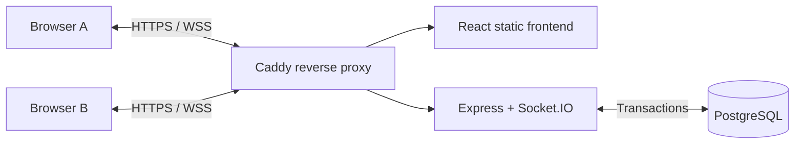

# Product Brainstorm — Engineering design notes

## System overview



**Deployment boundary:** A single VPS hosts all services in Docker Compose. Only ports 80/443 are public; PostgreSQL is on a Docker-private network. This is not a microservices architecture.

## Authentication vs authorization

Authentication is possession of a high-entropy *board-specific secret*, not verification of a human identity. `POST /api/boards` creates a board and three random secrets (owner/editor/viewer) whose SHA-256 digests are stored in `board_tokens`. Only the owner secret is returned initially.

The browser keeps the secret after `#token=` in the URL, which is not included in HTTP requests. It sends the token explicitly through an `Authorization: Bearer` HTTP header or Socket.IO handshake `auth`. Authorization checks `board_id + token_hash`. A viewer can read but cannot mutate. Only an owner can clear the board or rotate invitation tokens. Rotating an editor/viewer token disconnects sockets that held that role. A person with the owner link has full control; this is deliberately NOT enterprise identity management.

## Operation sequence

```mermaid
sequenceDiagram
  participant A as Editor browser
  participant S as Socket.IO server
  participant P as PostgreSQL
  participant B as Other browser
  A->>S: board:operation (operationId, expectedVersion, patch)
  S->>P: BEGIN; SELECT board FOR UPDATE
  P-->>S: Current board revision
  S->>P: Check operation ID + object version
  S->>P: Persist object + operation + increment sequence
  P-->>S: COMMIT
  S-->>A: Acknowledgement (committed event)
  S-->>B: board:applied (sequence, object)
```

- Every operation has a UUID (idempotency key). If the same operation ID is retried, the server returns the original committed result.
- `UPDATE` and `DELETE` require `expectedVersion`. If stale, the server returns a 409-style Socket.IO acknowledgement; the client resynchronizes rather than overwriting another user without notice.
- The server serializes writes per board by locking the board row in a transaction; it writes an ordered log entry after each successful mutation.
- The operation broadcast happens **after** database commit. A failed broadcast does not roll back durable data; disconnected clients recover from snapshots.
- The front end uses local previews during pointer motion and sends a single committed operation at pointer release. Live cursors are ephemeral and are not written to PostgreSQL.

## Reconnection

A connecting socket joins its authorized board room before the server reads a repeatable-read snapshot. The client buffers early events until the snapshot arrives and then applies only events with `seq` greater than the snapshot's sequence. A sequence gap triggers a fresh snapshot. This favors correctness and simplicity over complex offline operation replay.

## Data layout

- `boards`: board metadata, monotonically increasing `sequence`
- `board_tokens`: hashed owner/editor/viewer access tokens
- `board_objects`: durable JSONB object body, numeric version, timestamps
- `board_operations`: UUID operation ID, board sequence and durable applied result

DB indexes target per-board object listing and per-board operation scanning. No global object broadcasts are allowed.

## Failure scenarios and expected handling

| Scenario | Expected behavior |
|---|---|
| User A edits same object as B | One conditional update wins; stale operation is rejected, client reloads |
| Client disconnects before an acknowledgement | Operation may or may not have committed; reconnect snapshot reconciles |
| Server restarts | Socket reconnects; objects reload from PostgreSQL |
| Browser refresh | New socket authenticates and receives a full board snapshot |
| Role token rotated | Previous invitations fail; active sessions of that role are disconnected |
| Database unavailable | Readiness fails; mutations return an error, no false success acknowledgement |
| Two unrelated boards active | Separate Socket.IO rooms and database `board_id` constraints prevent broadcast mixing |
| Owner loses link | No automated recovery (intentional limitation) |

## Scalability and observability roadmap

Current server is **one instance**. Socket.IO rooms, presence and rate limiting are process-local. Load-testing scripts provide measured operation throughput; they are not proof of capacity before execution. If one instance becomes a measured bottleneck, add a Redis Socket.IO adapter, shared rate limiter, appropriate transport/load-balancer strategy, multi-replica tests, and proper process monitoring. Offsite backups and managed database services improve recovery without changing collaborative algorithms. A rich shared text editor could require a CRDT (Yjs/Automerge), but simple shape transformations can remain version-checked operations.

## Known trade-offs

- JSONB image data is intentionally capped; move binary images to S3-compatible storage for large users.
- Auth is anonymous capability-link based, not a user/account system.
- Preview updates are optimistic; with rapid consecutive edits, a conflict can require user retry.
- Browser end-to-end coverage, deployment acceptance tests, and Redis scaling are future work, not completed promises.
